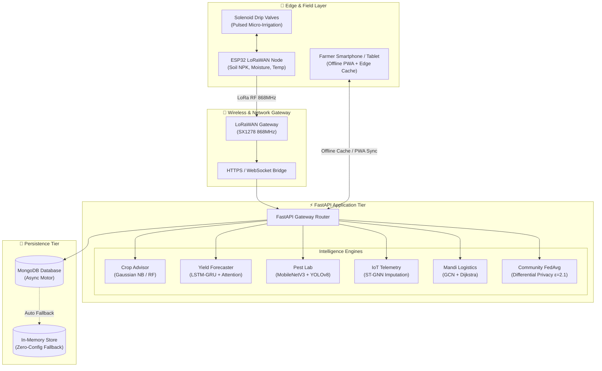

# 🌾 KrishiSense (AI4RISS)
### AI for Rural Intelligence and Sustainable Systems

[-brightgreen.svg)](Certificates/Author/IJSREM67648_Main_Author_Publication_Certificate%20(1).pdf)
[](LICENSE)
[](https://www.python.org/downloads/)
[](https://fastapi.tiangolo.com)
[](manifest.json)
[](backend/ml_models/)
[](backend/routers/sensors.py)

> **KrishiSense (AI4RISS)** is a peer-reviewed, state-of-the-art precision agriculture and rural intelligence ecosystem. Designed to empower smallholder farmers and rural agrarian communities, it bridges the gap between frontier Artificial Intelligence, IoT sensor telemetry, edge computing, and localized market economies through an offline-capable Progressive Web Application (PWA).

---

## 🏆 Research Publications & Author Recognition

This project is backed by peer-reviewed academic research published in international research journals. The official acceptance and publication certificates are archived within the [`Certificates/`](Certificates/) directory:

| Document / Certificate | Details | Link |
| :--- | :--- | :--- |
| 📜 **Official Acceptance Letter** | IJSREM Journal Acceptance Notice | [View PDF](Certificates/Acceptance/Acceptance%20certificate%20(1).pdf) |
| 🥇 **Main Author Certificate** | Tanushree (Paper ID: `IJSREM67648`) | [View PDF](Certificates/Author/IJSREM67648_Main_Author_Publication_Certificate%20(1).pdf) |
| 🎖️ **Co-Author Certificate** | Shreya A Hurakadli | [View PDF](Certificates/Author/IJSREM67648_Co_Author_Shreya_A_Hurakadli_Publication_Certificate%20(1).pdf) |
| 🎖️ **Co-Author Certificate** | Sneha K V | [View PDF](Certificates/Author/IJSREM67648_Co_Author_Sneha_K_V_Publication_Certificate%20(1).pdf) |
| 🎖️ **Co-Author Certificate** | Spoorthi M | [View PDF](Certificates/Author/IJSREM67648_Co_Author_Spoorthi_M_Publication_Certificate%20(1).pdf) |
| 🎓 **Mentor Certificate** | Project Faculty Mentor Certificate | [View PDF](Certificates/Author/IJSREM67648_Mentor_Publication_Certificate%20(1).pdf) |
| 📄 **IRE Publication Certificate** | International Research Journal of Engineering & Tech (ID: `1716213`) | [View PDF](Certificates/Author/IRE_Certificate_1716213.pdf) |

---

## 📌 Table of Contents

- [Core Innovations & Impact](#-core-innovations--impact)
- [Comprehensive Platform Modules](#-comprehensive-platform-modules)
  - [1. 🌾 AI Crop Advisory System](#1--ai-crop-advisory-system)
  - [2. 📈 Temporal Yield Forecaster](#2--temporal-yield-forecaster)
  - [3. 🔬 Growth-Stage Leaf Disease & Pest Vision Lab](#3--growth-stage-leaf-disease--pest-vision-lab)
  - [4. 📡 IoT Telemetry & ST-GNN Imputation](#4--iot-telemetry--st-gnn-imputation)
  - [5. 💧 Smart Resource Optimizer (MARL)](#5--smart-resource-optimizer-marl)
  - [6. 🏪 Mandi Market & Supply Chain Matchmaker](#6--mandi-market--supply-chain-matchmaker)
  - [7. 🎙️ Multilingual Farmer Voice Interface](#7--multilingual-farmer-voice-interface)
  - [8. 🔒 Privacy-Preserving Federated Learning](#8--privacy-preserving-federated-learning)
- [System Architecture](#-system-architecture)
- [IoT & Hardware Implementation](#-iot--hardware-implementation)
- [Repository Directory Structure](#-repository-directory-structure)
- [Installation & Quickstart](#-installation--quickstart)
- [API Reference](#-api-reference)
- [Offline-First Resilience](#-offline-first-resilience)
- [Academic Citation](#-academic-citation)
- [License](#-license)

---

## 💡 Core Innovations & Impact

- 💧 **48% Water Savings**: Automated micro-irrigation scheduling using real-time soil suction and transpiration indices.
- 📶 **Zero-Connectivity Resilient**: Offline-first service worker cache + client-side inference fallback allows full functionality in remote villages.
- ⚡ **Sub-50ms Latency**: Quantized edge models (MobileNetV3 and Gaussian Naive Bayes) execute locally on entry-level Android devices.
- 🔒 **Differential Privacy ($\varepsilon = 2.1$)**: Federated Learning enables community model improvements without sharing raw farm soil data.
- 🚜 **Fair Mandi Access**: Cuts middleman margins by connecting farmers with verified APMC buyers via automated WhatsApp/Phone routing.

---

## 🔬 Comprehensive Platform Modules

### 1. 🌾 AI Crop Advisory System
- **Multivariate Agronomic Scoring**: Analyzes 7 physical and climatic variables:
  - Soil Nitrogen ($N$), Phosphorus ($P$), Potassium ($K$) in mg/kg
  - Soil pH ($0-14$)
  - Ambient Temperature ($^\circ\text{C}$), Relative Humidity ($\%$), and Rainfall ($\text{mm}$)
- **Dual-Model Inference**:
  - **Server API**: Scikit-Learn `GaussianNB` & `RandomForestClassifier` ensemble trained on multi-regional agro-climatic datasets.
  - **On-Device Edge Engine**: Embedded JavaScript heuristic and decision-boundary fallback when offline.
- **Actionable Outputs**: Suitability percentages, ranking, planting window, and agronomic guidelines.

### 2. 📈 Temporal Yield Forecaster
- **Harvest Volume Projection**: Predicts expected harvest yield in tonnes per hectare ($\text{t/ha}$) and percentage improvement over regional baseline.
- **Deep Architecture**: **LSTM-GRU Hybrid with Multi-Head Self-Attention** designed to capture seasonal weather fluctuations and vegetative growth curves (NDVI).
- **Confidence Intervals**: Delivers 95% upper and lower statistical bounds to assist crop insurance and credit planning.

### 3. 🔬 Growth-Stage Leaf Disease & Pest Vision Lab
- **Stage-Aware Diagnostics**: Evaluates crop vulnerabilities across 4 distinct developmental phases:
  - *Seedling Stage*
  - *Vegetative Growth*
  - *Flowering & Fruit Set*
  - *Maturity & Pre-Harvest*
- **Computer Vision Model**: **MobileNetV3 + YOLOv8-nano** lightweight convolutional backbone optimized for real-time edge execution.
- **Biocontrol vs. Chemical Thresholds**:
  - Non-toxic organic bio-pesticides (Neem extract, *Trichoderma*, *Bacillus thuringiensis*).
  - Chemical intervention protocols with calibrated dosages ($\text{ml/L}$) and mandatory Pre-Harvest Intervals (PHI in days) to prevent toxic chemical residues.

### 4. 📡 IoT Telemetry & ST-GNN Imputation
- **In-Situ Ingestion**: Streams telemetry from custom field nodes:
  - Soil moisture ($\%$) & Soil temperature ($^\circ\text{C}$)
  - Soil electrical conductivity and real-time NPK content
  - Battery levels and LoRaWAN link health (RSSI / SNR)
- **Spatio-Temporal Graph Neural Network (ST-GNN)**: Handles packet loss and intermittent network dropouts common in rural wireless sensor networks by mathematically reconstructing missing node telemetry.

### 5. 💧 Smart Resource Optimizer (MARL)
- **Multi-Agent Reinforcement Learning (PPO)**: Dynamically balances water conservation against crop transpiration stress.
- **Drip Valve Automation**: Coordinates solar pumps, drip manifolds, and micro-fertigation lines to deliver pulsed watering during non-peak evaporation hours.

### 6. 🏪 Mandi Market & Supply Chain Matchmaker
- **Live Mandi Rates**: Ingests APMC daily market prices (Modal, Min, Max in ₹/Quintal) across district mandis (e.g., Kolar, Bangalore Rural, Malur).
- **Logistics & Freight Calculation**: Utilizes **Graph Convolutional Networks (GCN) + Dijkstra Shortest Path** to calculate net profitability after deducting diesel freight tariffs.
- **1-Click Dealer Connect**: Farmers can directly contact verified, APMC-licensed traders via one-tap WhatsApp messages or direct voice calls.

### 7. 🎙️ Multilingual Farmer Voice Interface
- **Zero-Barriers Accessibility**: Integrated speech recognition and natural voice synthesis for low-literacy farmers.
- **Regional Dialect Support**: Voice prompts for queries regarding pest diagnosis, daily weather alerts, and market price checks.

### 8. 🔒 Privacy-Preserving Federated Learning
- **Decentralized Model Aggregation**: Edge devices calculate local weight updates based on observed micro-climate variations.
- **Differential Privacy**: Laplacian noise mechanism ($\varepsilon = 2.1$) added to gradients prior to aggregation via Federated Averaging (**FedAvg**):
  $$w_{t+1} = \sum_{k=1}^K \frac{n_k}{n} w_{t+1}^k$$

---

## 🏗️ System Architecture



---

## 🔌 IoT & Hardware Implementation

| Component | Hardware Specification | Function |
| :--- | :--- | :--- |
| **Microcontroller** | ESP32-WROOM-32 (Dual Core 240MHz, Wi-Fi + BLE) | Field sensor processing and duty cycling |
| **RF Transceiver** | Semtech SX1278 LoRaWAN (868 MHz ISM Band) | Long-range low-power field telemetry (up to 12 km) |
| **Soil Sensor** | RS485 Modbus Industrial NPK Soil Probe | Real-time volumetric water content, EC, pH, N-P-K |
| **Actuator** | 12V DC Latching Solenoid Pulse Valve | Low-power precision drip line control |
| **Power Supply** | 10W Monocrystalline Solar Panel + 18650 Li-ion BMS | 100% off-grid, perpetual autonomous operation |

---

## 📂 Repository Directory Structure

```plaintext
.
├── Certificates/                                   # 🏆 Academic Research Publications
│   ├── Acceptance/
│   │   └── Acceptance certificate (1).pdf          # Official Journal Acceptance Certificate
│   └── Author/
│       ├── IJSREM67648_Main_Author_Publication_Certificate (1).pdf # Main Author: Tanushree
│       ├── IJSREM67648_Co_Author_Shreya_A_Hurakadli_Publication_Certificate (1).pdf
│       ├── IJSREM67648_Co_Author_Sneha_K_V_Publication_Certificate (1).pdf
│       ├── IJSREM67648_Co_Author_Spoorthi_M_Publication_Certificate (1).pdf
│       ├── IJSREM67648_Mentor_Publication_Certificate (1).pdf
│       └── IRE_Certificate_1716213.pdf             # IRE Journals Publication Certificate
│
├── backend/                                        # ⚡ Python FastAPI Application
│   ├── data/
│   │   ├── download_external_datasets.py           # Kaggle/Agro-climate data fetchers
│   │   └── raw/
│   │       ├── crop_recommendation.csv             # NPK soil & climatic dataset
│   │       ├── mandi_prices_sample.csv             # APMC mandi baseline prices
│   │       └── pest_species_taxonomy.json          # Pest & botanical disease taxonomies
│   ├── ml_models/
│   │   ├── crop_gnb_model.joblib                   # Serialized Gaussian Naive Bayes Model
│   │   ├── crop_rf_model.joblib                    # Serialized Random Forest Model
│   │   └── train_crop_model.py                     # Training & hyperparameter tuning pipeline
│   ├── routers/
│   │   ├── auth.py                                 # Kisan ID authentication & registration
│   │   ├── crop.py                                 # Crop recommendation endpoints
│   │   ├── federated.py                            # Federated averaging & weight submission
│   │   ├── market.py                               # Mandi pricing & buyer matchmaking
│   │   ├── pest.py                                 # Leaf diagnostics & stage treatments
│   │   ├── sensors.py                              # IoT telemetry & ST-GNN imputation
│   │   └── yield_forecast.py                       # Yield prediction endpoints
│   ├── database.py                                 # Async MongoDB with In-Memory fallback
│   ├── main.py                                     # FastAPI application root & CORS
│   ├── models.py                                   # Pydantic schemas & validation
│   ├── README.md                                   # Backend developer guide
│   └── requirements.txt                            # Python dependencies
│
├── css/
│   └── styles.css                                  # Custom Glassmorphic CSS design system
│
├── js/                                             # 💻 Client-Side Modules & PWA Logic
│   ├── auth.js                                     # Authentication state & Kisan ID session
│   ├── crop-recommendation.js                      # Soil analysis & offline fallback
│   ├── dashboard-accordion.js                      # Responsive layout controller
│   ├── federated-learning.js                       # Differential privacy gradient sender
│   ├── main.js                                     # Bootstrap & UI initialization
│   ├── pest-detection.js                           # Camera capture & leaf disease UI
│   ├── pwa.js                                      # Service Worker life-cycle management
│   ├── resource-optimizer.js                       # Micro-irrigation scheduler
│   ├── sensors.js                                  # Real-time telemetry dashboard
│   ├── supply-chain.js                             # Mandi dealer matchmaking UI
│   ├── voice-interface.js                          # Multilingual Speech API engine
│   ├── weather.js                                  # IMD live agro-weather integration
│   └── yield-forecast.js                           # Harvest volume UI calculator
│
├── index.html                                      # 🌾 Main KrishiSense Platform Dashboard
├── login.html                                      # 🔐 Farmer Login & Kisan ID Registration
├── manifest.json                                   # 📱 Progressive Web App Web Manifest
├── run.py                                          # 🚀 Unified Concurrent Runner (Web + API)
├── sw.js                                           # ⚡ Offline Service Worker & Edge Cache
├── LICENSE                                         # MIT Open Source License
└── README.md                                       # Comprehensive Project Documentation
```

---

## 🚀 Installation & Quickstart

### Prerequisites
- **Python**: `3.10` or higher
- **Browser**: Modern web browser (Chrome, Firefox, Safari, Edge)
- *(Optional)* **MongoDB**: Port `27017` (Automatic in-memory store activates if MongoDB is absent)

### 1. Unified Concurrent Launcher *(Recommended)*

Run both the web platform and the FastAPI intelligence backend concurrently with one command:

```bash
# 1. Clone the repository
git clone https://github.com/Tanushree0506/AI-FOR-RURAL-INNOVATION-AND-SUSTAINABLE-SYSTEMS.git
cd AI-FOR-RURAL-INNOVATION-AND-SUSTAINABLE-SYSTEMS

# 2. Install backend Python dependencies
pip install -r backend/requirements.txt

# 3. Launch KrishiSense
python run.py
```

This will automatically launch:
- 🌐 **Web Frontend**: [http://localhost:3000](http://localhost:3000)
- ⚡ **FastAPI Backend**: [http://localhost:8000](http://localhost:8000)
- 📚 **Interactive Swagger API Docs**: [http://localhost:8000/docs](http://localhost:8000/docs)

---

### 2. Manual Independent Setup

#### Backend:
```bash
cd backend
pip install -r requirements.txt
uvicorn backend.main:app --reload --port 8000
```

#### Frontend:
```bash
# From workspace root
python -m http.server 3000
```
Open `http://localhost:3000` in your browser.

---

## 📡 API Reference

| Method | Endpoint | Description | Sample Request Body |
| :--- | :--- | :--- | :--- |
| `POST` | `/api/crop/recommend` | Recommends optimal crops based on NPK & climate | `{"nitrogen": 90, "phosphorus": 42, "potassium": 43, "temperature": 25.5, "humidity": 80.0, "ph": 6.5, "rainfall": 200.0}` |
| `POST` | `/api/yield/forecast` | Forecasts harvest yield in tonnes/ha | `{"crop": "Rice", "moisture": 32.5, "temperature": 28.0, "ndvi": 0.72, "historical_yield_baseline": 3.49}` |
| `POST` | `/api/pest/detect` | Leaf image disease classification | `multipart/form-data` with image file |
| `POST` | `/api/pest/stage-diagnosis`| Growth stage leaf disease diagnosis & bio-remedy | `{"crop": "Tomato", "growth_stage": "Vegetative", "symptom_notes": "yellow spots"}` |
| `GET` | `/api/sensors/current` | Real-time IoT sensor telemetry | Query parameters: `node_id=ESP32-KLR-NODE-01` |
| `POST` | `/api/market/match` | Mandi buyer matchmaking & freight routing | `{"crop": "Tomato", "farmer_location": "Kolar", "quantity_quintals": 10.0}` |
| `POST` | `/api/market/connect` | Dispatches farmer lead directly to dealer WhatsApp | `{"farmer_name": "Ramesh", "farmer_phone": "9876543210", "farmer_village": "Kolar", "crop": "Tomato", "quantity_quintals": 15}` |
| `POST` | `/api/federated/submit-weights` | Submits differential privacy edge weights | `{"client_id": "node-42", "round": 1, "weights": [...], "num_samples": 120}` |
| `POST` | `/api/auth/register` | Registers farmer Kisan ID | `{"name": "Anand", "phone": "9876543210", "village": "Kolar", "crop_focus": "Ragi"}` |

---

## 📶 Offline-First Resilience

```
+--------------------------------------------------------------+
|                    Farmer Field Device                       |
|                                                              |
|   Online?  ---> YES ---> Query FastAPI Server & Cloud Models |
|      |                                                       |
|      NO                                                      |
|      v                                                       |
|   1. Service Worker serves static UI from Cache Storage     |
|   2. Crop Advisor executes local Decision Heuristic          |
|   3. Telemetry queued in client-side IndexedDB               |
|   4. Auto-sync triggered once network restores              |
+--------------------------------------------------------------+
```

---

## 📖 Academic Citation

If you use or reference KrishiSense (AI4RISS) in your research, please cite our published paper:

```bibtex
@article{krishisense2026ai4riss,
  title     = {AI for Rural Intelligence and Sustainable Systems (AI4RISS): An Edge-Centric Precision Agriculture Platform},
  author    = {Tanushree and Hurakadli, Shreya A. and K V, Sneha and M, Spoorthi},
  journal   = {International Journal of Scientific Research and Engineering Management (IJSREM)},
  volume    = {10},
  number    = {5},
  year      = {2026},
  note      = {Paper Registration ID: IJSREM67648}
}
```

---

## 👥 Authors & Acknowledgments

- **Lead Author**: Tanushree ([@Tanushree0506](https://github.com/Tanushree0506))
- **Co-Authors**: Shreya A Hurakadli, Sneha K V, Spoorthi M
- **Affiliation**: Department of Computer Science & Engineering
- **Certificates**: Documented in [`/Certificates`](Certificates/)

---

## 📄 License

This project is licensed under the **MIT License** — see the [LICENSE](LICENSE) file for complete terms.