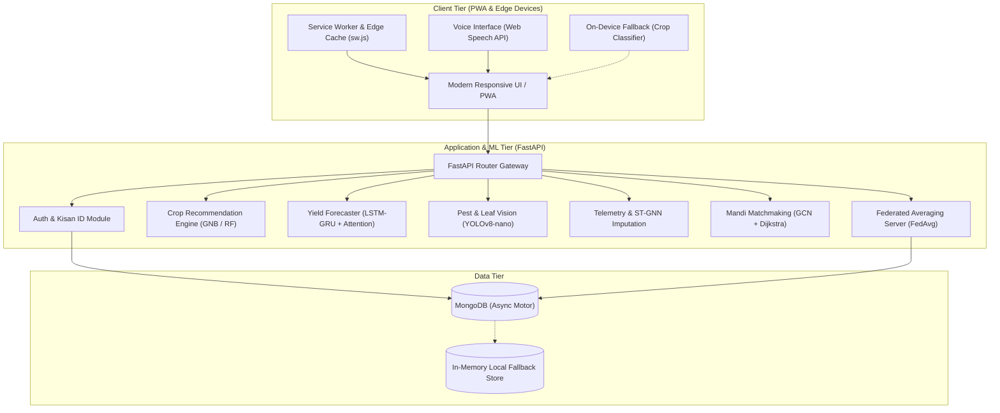

# 🌾 KrishiSense (AI4RISS)
### AI for Rural Intelligence and Sustainable Systems

[](https://opensource.org/licenses/MIT)
[](https://www.python.org/downloads/)
[](https://fastapi.tiangolo.com)
[](https://developer.mozilla.org/en-US/docs/Web/Progressive_web_apps)
[](https://scikit-learn.org)

**KrishiSense (AI4RISS)** is an end-to-end, privacy-preserving, AI-driven precision agriculture and rural intelligence platform. Built specifically for smallholder farmers and agrarian communities, it combines edge-computing, machine learning, IoT sensor telemetry, and market intelligence into a unified, offline-capable Progressive Web Application (PWA).

---

## 📌 Table of Contents

- [Key Features](#-key-features)
- [System Architecture & AI/ML Models](#-system-architecture--aiml-models)
- [Repository Structure](#-repository-structure)
- [Getting Started](#-getting-started)
  - [Prerequisites](#prerequisites)
  - [Quick Start (Unified Launcher)](#1-quick-start-unified-launcher-recommended)
  - [Manual Setup (Frontend & Backend)](#2-manual-setup)
- [API Reference](#-api-reference)
- [Offline-First & Edge AI Capabilities](#-offline-first--edge-ai-capabilities)
- [Privacy-Preserving Federated Learning](#-privacy-preserving-federated-learning)
- [Tech Stack](#-tech-stack)
- [License](#-license)

---

## 🌟 Key Features

### 1. 🌾 Intelligent Crop Advisory
- **Soil & Climate Optimization**: Evaluates soil Nitrogen ($N$), Phosphorus ($P$), Potassium ($K$), Soil pH, ambient temperature, relative humidity, and rainfall.
- **Dual-Engine Execution**: Uses trained **Gaussian Naive Bayes** and **Random Forest** models with automatic on-device fallback when offline.

### 2. 📈 Yield Forecasting
- **Harvest Volume Projections**: Estimates crop yield per hectare based on cumulative seasonal metrics, historical agro-climatic trends, and irrigation schedules.
- **Model**: **LSTM-GRU Hybrid with Self-Attention** for accurate temporal modeling.

### 3. 🔬 Leaf Disease & Pest Diagnostics
- **Real-Time Vision Edge Lab**: Upload leaf imagery directly from field cameras or smartphones to detect infestations and fungal/bacterial diseases.
- **Instant Bio-Remedies**: Provides targeted, eco-friendly organic remedies and calibrated chemical thresholds to avoid soil degradation.
- **Model**: **YOLOv8-nano Vision Edge Diagnostic**.

### 4. 📡 IoT Telemetry & Sensor Analytics
- **Live In-Situ Monitoring**: Streams soil moisture, soil temperature, conductivity, and ambient micro-climate parameters.
- **Missing Data Imputation**: Employs **Spatio-Temporal Graph Neural Networks (ST-GNN)** to impute missing readings from sporadic rural sensor nodes.

### 5. 💧 Smart Resource Optimizer
- **Precision Irrigation & Fertilization**: Optimizes water delivery and fertilizer application cycles to prevent run-off, cut operational costs, and conserve ground water.
- **Framework**: **Multi-Agent Reinforcement Learning (MARL / PPO)**.

### 6. 🏪 Mandi & Supply Chain Matchmaking
- **APMC Market Intelligence**: Tracks live mandi commodity prices, price volatility, and demand indices.
- **Smart Logistics**: Connects farmers directly with regional buyers, calculating lowest-cost logistics routes using **Graph Convolutional Networks (GCN) + Dijkstra Shortest Path**.

### 7. 🎙️ Multilingual Farmer Voice Interface
- **Accessibility for All**: Integrated voice recognition and speech synthesis, enabling rural farmers to interact naturally via spoken regional languages and voice prompts.

### 8. 🔒 Community Federated Learning
- **Decentralized Model Retraining**: Farmers' edge devices collectively improve crop models by submitting encrypted local weight gradients.
- **Differential Privacy ($\varepsilon = 2.1$)**: Ensures zero raw farm data leaves the farmer's personal device.

---

## 🧠 System Architecture & AI/ML Models



### Model Specifications

| Module | Architecture / Algorithm | Purpose |
| :--- | :--- | :--- |
| **Crop Advisor** | Gaussian Naive Bayes / Random Forest | Multiclass agro-climatic crop classification |
| **Yield Forecaster** | LSTM-GRU Hybrid + Self-Attention | Multi-horizon harvest volume prediction |
| **Pest Detection** | YOLOv8-nano Vision | Edge-optimized plant leaf disease classification |
| **Sensor Telemetry** | Spatio-Temporal Graph Neural Network (ST-GNN) | Spatial node imputation for missing sensor data |
| **Supply Chain** | GCN + Dijkstra Routing | Fair mandi buyer matchmaking & freight routing |
| **Federated Edge** | Federated Averaging (FedAvg) + Differential Privacy ($\varepsilon=2.1$) | Collaborative privacy-preserving model tuning |

---

## 📂 Repository Structure

```plaintext
.
├── backend/
│   ├── data/
│   │   ├── download_external_datasets.py   # Dataset ingestion scripts
│   │   └── raw/                            # Sample raw datasets (crops, mandi prices, pests)
│   ├── ml_models/
│   │   ├── crop_gnb_model.joblib           # Pretrained Gaussian Naive Bayes model
│   │   ├── crop_rf_model.joblib            # Pretrained Random Forest model
│   │   └── train_crop_model.py             # Model training & serialization pipeline
│   ├── routers/
│   │   ├── auth.py                         # Farmer authentication & Kisan profile
│   │   ├── crop.py                         # Crop recommendation endpoints
│   │   ├── federated.py                    # Edge weight aggregation (FedAvg)
│   │   ├── market.py                       # Mandi pricing & buyer matchmaking
│   │   ├── pest.py                         # Leaf diagnostics & remedies
│   │   ├── sensors.py                      # IoT soil & telemetry endpoints
│   │   └── yield_forecast.py               # Yield projection endpoints
│   ├── database.py                         # Async MongoDB connector with in-memory fallback
│   ├── main.py                             # FastAPI application entrypoint
│   ├── models.py                           # Pydantic schemas & data structures
│   ├── README.md                           # Backend-specific documentation
│   └── requirements.txt                    # Python dependencies
│
├── css/
│   └── styles.css                          # Modern glassmorphic agricultural design system
│
├── js/
│   ├── auth.js                             # Client authentication & session management
│   ├── crop-recommendation.js              # Soil NPK advisory client logic
│   ├── dashboard-accordion.js              # Interactive UI layout controls
│   ├── federated-learning.js               # Edge federated update submission
│   ├── main.js                             # Application bootstrapping
│   ├── pest-detection.js                   # Client leaf upload & diagnostics
│   ├── pwa.js                              # Service worker registration & offline handler
│   ├── resource-optimizer.js               # Water & fertilizer scheduling UI
│   ├── sensors.js                          # Real-time telemetry visualization
│   ├── supply-chain.js                     # Mandi market & logistics calculator
│   ├── voice-interface.js                  # Speech-to-text / text-to-speech assistant
│   ├── weather.js                          # IMD agro-weather integration
│   └── yield-forecast.js                   # Yield prediction client UI
│
├── index.html                              # Core KrishiSense platform dashboard
├── login.html                              # Farmer login & Kisan ID registration
├── manifest.json                           # PWA web app manifest
├── run.py                                  # Unified multi-threaded project runner
├── sw.js                                   # Offline caching Service Worker
└── README.md                               # Project documentation
```

---

## 🚀 Getting Started

### Prerequisites

- **Python**: Version 3.10 or higher
- **Web Browser**: Any modern browser (Chrome, Edge, Safari, Firefox) with PWA support
- *(Optional)* **MongoDB**: Running locally on port `27017` (not required; KrishiSense includes automatic in-memory fallback)

---

### 1. Quick Start: Unified Launcher *(Recommended)*

KrishiSense includes a unified multi-threaded launcher `run.py` that spins up both the **FastAPI backend** and the **Web Frontend** concurrently:

```bash
# 1. Clone the repository
git clone https://github.com/Tanushree0506/AI-FOR-RURAL-INNOVATION-AND-SUSTAINABLE-SYSTEMS.git
cd AI-FOR-RURAL-INNOVATION-AND-SUSTAINABLE-SYSTEMS

# 2. Install backend dependencies
pip install -r backend/requirements.txt

# 3. Launch KrishiSense
python run.py
```

This will automatically:
- Start the **Web Application** at `http://localhost:3000`
- Start the **FastAPI ML API** at `http://localhost:8000`
- Open your default web browser to the dashboard

---

### 2. Manual Setup

If you prefer running services independently in separate terminal windows:

#### Terminal 1 — FastAPI Backend:
```bash
cd backend
pip install -r requirements.txt
uvicorn backend.main:app --reload --port 8000
```
- Interactive Swagger API Documentation: [http://localhost:8000/docs](http://localhost:8000/docs)
- Interactive ReDoc: [http://localhost:8000/redoc](http://localhost:8000/redoc)

#### Terminal 2 — Frontend:
```bash
# From the project root
python -m http.server 3000
```
Open [http://localhost:3000](http://localhost:3000) in your browser.

---

## 📡 API Reference

| Method | Endpoint | Description | Input Payload / Parameters |
| :--- | :--- | :--- | :--- |
| `POST` | `/api/crop/recommend` | Recommends optimal crops | `{ N, P, K, temperature, humidity, ph, rainfall }` |
| `POST` | `/api/yield/forecast` | Predicts expected yield (tonnes/ha) | `{ crop, area_hectares, rainfall_mm, fertilizer_kg, soil_type }` |
| `POST` | `/api/pest/detect` | Classifies leaf pests and recommends treatments | Leaf image upload (multipart/form-data) |
| `GET` | `/api/sensors/current` | Real-time IoT soil & weather telemetry | Query params: `node_id`, `field_id` |
| `POST` | `/api/market/match` | Mandi buyer matchmaking & freight routing | `{ crop, quantity_quintals, source_location }` |
| `POST` | `/api/federated/submit-weights`| Submits client-side privacy-preserving weights | `{ client_id, round, weights, num_samples }` |
| `POST` | `/api/auth/register` | Registers a new Kisan ID | `{ name, phone, state, district, land_acres }` |
| `POST` | `/api/auth/login` | Authenticates farmer session | `{ phone, password }` |

---

## 📶 Offline-First & Edge AI Capabilities

Rural farming environments frequently suffer from poor or zero cellular connectivity. KrishiSense is engineered with resilience at its core:

1. **Service Worker Caching (`sw.js`)**: Static assets, stylesheets, scripts, and interface components are pre-cached upon initial load.
2. **On-Device ML Evaluation**: If the backend API is unreachable, the frontend seamlessly switches to a client-side decision-tree / Naive Bayes heuristic model.
3. **Local Queue Synchronization**: User inputs, pest diagnostic logs, and telemetry are stored in client-side IndexedDB and synchronized automatically once internet connection is restored.

---

## 🛡️ Privacy-Preserving Federated Learning

Traditional agricultural platforms aggregate farmer data onto centralized servers, raising data sovereignty and privacy concerns. **KrishiSense** utilizes **Federated Averaging (FedAvg)**:

1. **Local Model Training**: Models train locally on edge devices utilizing local soil and weather observations.
2. **Differential Privacy ($\varepsilon = 2.1$)**: Calibrated Laplacian noise is added to weight gradients before transmission.
3. **Global Aggregation**: The central coordinator updates global model weights using weighted averaging:
   $$w_{t+1} = \sum_{k=1}^K \frac{n_k}{n} w_{t+1}^k$$
   where $n_k$ is the number of data samples on client $k$, and $n$ is the total samples across all participating nodes.

---

## 💻 Tech Stack

- **Frontend**: HTML5, Vanilla CSS3 (Custom Glassmorphic design tokens), Vanilla Modern JavaScript (ES6+), Progressive Web App (PWA).
- **Backend**: Python 3.10+, FastAPI, Uvicorn, Pydantic v2.
- **Machine Learning**: Scikit-Learn, NumPy, Joblib, YOLO Vision architecture.
- **Data Persistence**: MongoDB (Async Motor driver) with automatic In-Memory fallback.
- **Audio & Accessibility**: Web Speech Recognition & SpeechSynthesis API.

---

## 📄 License

This project is licensed under the [MIT License](LICENSE) — free to use, modify, and distribute for educational, research, and commercial applications.
